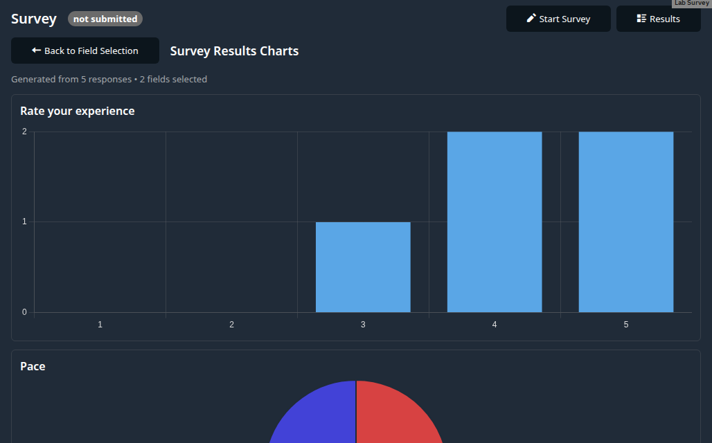

# Edrys Survey Module

A [SurveyJS](https://surveyjs.io/) survey for edrys-lite station rooms. Everyone in the station's room can answer
it; the station stores the answers and shows them as a list and as charts.

Import the module via:

`https://edrys-labs.github.io/module-survey/index.html`



## How it works

The module is shown in station rooms (`show-in: station`), so the teacher can change that in the module's *Show in*
setting.

- **Everyone in the room** (students, the station itself, a visiting teacher) sees a **Start Survey** button and a
  status badge. After completing the survey, the answer goes to the station, and the badge and button say
  **Submitted ✓** once the station confirmed it. If the station doesn't confirm within 5 seconds (it is closed or
  offline), the module says so and offers **Retry**. An unconfirmed answer is also sent again the next time the
  module loads.
- **The station** also gets a **Results** button: the answers to the current survey, newest first, with who sent
  them, and **Generate Charts** for the fields you pick. The chart follows the question type:

  | Question type                             | Chart                                    |
  | ----------------------------------------- | ---------------------------------------- |
  | `radiogroup`, `dropdown`, `boolean`       | pie, one slice per answer                |
  | `checkbox`, `tagbox`                      | bar per option, most chosen first        |
  | `rating`                                  | bar per value of the scale, unused ones too |
  | `text` with `inputType: number` / `range` | histogram                                |
  | free text, comments, matrices, …          | not charted                              |

The module follows the light or dark mode of the operating system.

## Configuration

Everything is in the module's **station settings** (`stationConfig`):

| Field         | Type      | Meaning                                                                                  |
| ------------- | --------- | ---------------------------------------------------------------------------------------- |
| `survey`      | code area | The survey as SurveyJS JSON. Required.                                                   |
| `allowRetake` | boolean   | Off (default): one answer per user. On: users can answer again, e.g. on a shared station PC. |

The survey can be pasted as JSON in the settings form, or written in the YAML config editor, as a JSON string or
as YAML:

```yaml
survey: |
  {
    "title": "Lab Feedback",
    "pages": [
      {
        "name": "page1",
        "elements": [
          { "type": "text", "name": "name", "title": "Your name" },
          { "type": "rating", "name": "experience", "title": "Rate your experience", "rateMax": 5 },
          { "type": "radiogroup", "name": "pace", "title": "Pace", "choices": ["slow", "ok", "fast"] }
        ]
      }
    ]
  }
allowRetake: false
```

```yaml
survey:
  title: Lab Feedback
  pages:
    - name: page1
      elements:
        - { type: rating, name: experience, title: Rate your experience, rateMax: 5 }
```

Build and test a survey with the [SurveyJS creator](https://surveyjs.io/create-free-survey), then copy its JSON.
Without a survey, or with invalid JSON, the module says what is wrong and where to fix it.

## Where the answers are stored

Answers are stored **only in the station's browser** (IndexedDB of the module's origin), per class and per survey:

- they survive a reload of the station, but are lost when that browser's site data is cleared;
- the teacher's and the students' browsers don't have them; there is no export yet;
- editing the survey starts a new set of results (and everyone can answer again); the station lists only the
  current survey's answers and says how many older ones it hides. Two survey modules in one class keep their
  results apart.

## Messages

Other modules can listen to or send these (module messages of the same module URL):

| Subject           | From → to                | Body                                                          |
| ----------------- | ------------------------ | ------------------------------------------------------------- |
| `surveyCompleted` | anyone → the room        | `{ id, surveyId, data }`: `data` is the SurveyJS result (an object of answers), `id` identifies this answer, `surveyId` the survey |
| `surveyStored`    | station → the sender     | `{ id }`: the answer with this `id` is stored                 |

The station stores only well-formed answers (`data` must be an object) to its own survey. An answer without `id` or
`surveyId` (from an older version of the module) is stored but not confirmed.

## Dependencies

Loaded from CDNs, with pinned versions and subresource integrity:

- [SurveyJS](https://surveyjs.io/) 2.5 (core, UI, default light and dark theme)
- [Chart.js](https://www.chartjs.org/) 4.5
- [Dexie.js](https://dexie.org/) 4.4 for IndexedDB
- edrys.js, water.css and open-iconic from `edrys-labs.github.io/module`

## Development

There is no build step: `index.html`, `app.js` and `style.css` are served as they are. The end-to-end tests are in
the `edrys-module-tests` repository (`modules/module-survey`); they run the module from a local checkout in a real
edrys-lite with a station and students.

## License

[MIT](LICENSE) © edrys-labs
